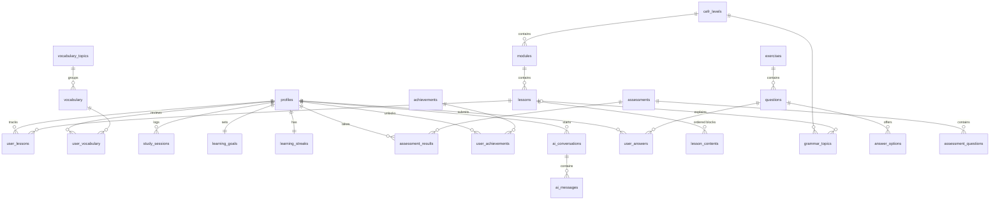

# ERD (planned — Phase 2)

Lesson ↔ vocabulary and lesson ↔ exercise references are stored in `lesson_contents.block` (`vocabulary` / `exercise` blocks),
matching the client model in `src/types/content.ts`.
